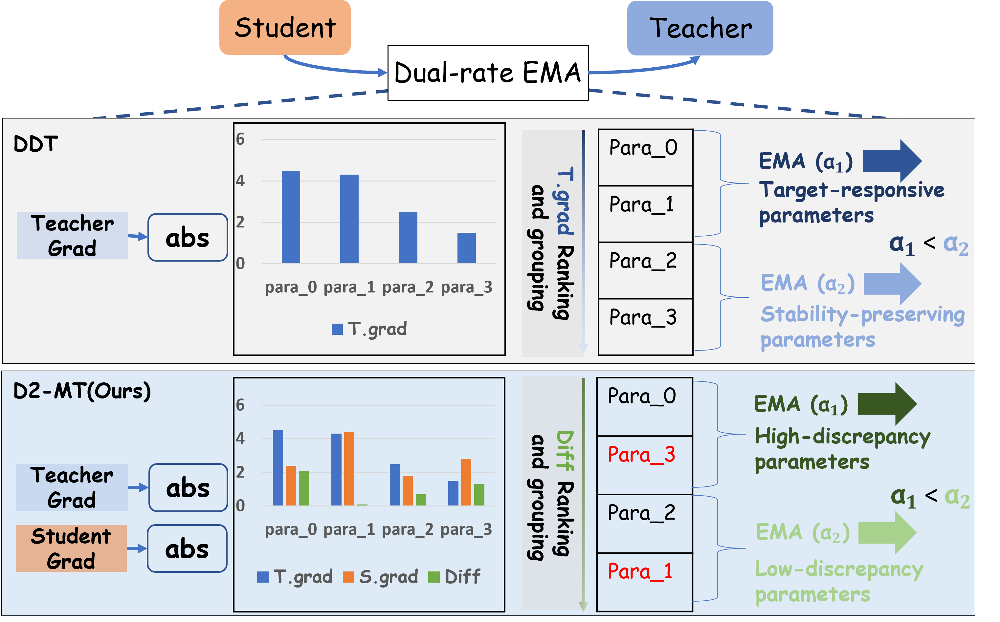
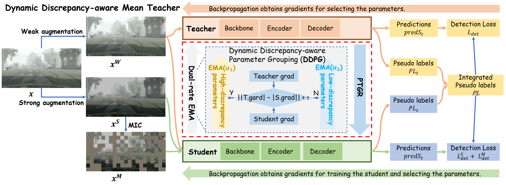

# D2-MT: Dynamic Discrepancy-Aware Mean Teacher for Source-Free Domain Adaptive Object Detection (ACM MM 2026)

## Abstract
Source-Free Domain Adaptive Object Detection (SF-DAOD) aims to transfer detectors to an unlabeled target domain without access to source data. To mitigate noisy pseudo-labels in this setting, existing mean-teacher methods apply parameter smoothing but suffer from slow adaptation and error accumulation. To address two key challenges in pseudo-label learning, namely instantaneous optimization inconsistency and long-term error accumulation, Dynamic Discrepancy-aware Mean Teacher (D2-MT) is proposed to enhance robustness across both parameter and temporal dimensions. First, Dynamic Discrepancy-aware Parameter Grouping (DDPG) explicitly measures gradient discrepancies between the teacher and student at the parameter level, enabling discrepancyaware updates that balance adaptation and stability. Second, Periodic Teacher-Guided Reset (PTGR) periodically reinitializes the student with EMA teacher weights and retrains it using updated pseudo-labels, effectively correcting accumulated errors and stabilizing optimization. 

<!-- 
 -->
<div align="center">

</div>

Overview of the D2-MT framework is shown in the following figure.

<!--  -->
 <div align="center">

</div>

## Environment Setup

```bash
conda create -n d2mt python=3.9
conda activate d2mt
conda install pytorch==1.13.1 torchvision==0.14.1 cudatoolkit=11.6 -c pytorch
pip install -r requirements.txt

# Compiling and testing Deformable DETR CUDA operators
cd models/ops
bash make.sh
python test.py
```

## Dataset

Our method used 3 popular SF-DAOD benchmarks:

- city2foggy: Cityscapes (source domain) → FoggyCityscapes with foggy level 0.02 (target domain).
- sim2city: Sim10k (source domain) → Cityscapes with `car` class (target domain).
- city2bdd: Cityscapes (source domain) → Bdd100k-daytime (target domain).

The raw data can be download from the official websites: [Cityscapes](https://www.cityscapes-dataset.com/downloads/),  [FoggyCityscapes](https://www.cityscapes-dataset.com/downloads/),  [Sim10k](https://fcav.engin.umich.edu/projects/driving-in-the-matrix), [Bdd100k](https://bdd-data.berkeley.edu/). The annotations are converted into COCO style, can download from [here](https://drive.google.com/file/d/1LB0wK9kO3eW8jpR2ZtponmYWe9x2KSiU/view?usp=sharing) (provided by [MRT-release](https://github.com/JeremyZhao1998/MRT-release)). The datasets are organized as:

- data
    - cityscapes
        - annotations
        - leftImg8bit
            - train
            - val
    - foggy_cityscapes
        - annotations
        - leftImg8bit_foggy
            - train
            - val 
    - bdd100k
        - annotations
        - images
            - 100k


## Training & Evaluation

The source pretrained weight of DefDETR-R50 can be downloaded from [DRU](https://github.com/lbktrinh/DRU).

- outputs
    - city2foggy
        - source_only
            - downloaded weight
    - sim2city
        - source_only
            - downloaded weight
    - city2bdd
        - source_only
            - downloaded weight

Then, you can use the following shell to train and evaluate ddt.
```bash
bash cconfigs/def-detr-base/city2foggy/teaching_mask_d2mt_withddt.sh
bash configs/def-detr-base/city2foggy/evaluation_teaching_mask_d2mt_withddt.sh
```
The training log file of city2foggy (best mAP = 47.6) is available at [log file](docs/city2foggy_log.txt)

The training log file of city2bdd (best mAP = 40.7) is available at [log file](docs/city2bdd_log.txt)

<!-- ## Citation
```
@inproceedings{Wang2026d2mt,
  title={D2-MT: Dynamic Discrepancy-Aware Mean Teacher for Source-Free Domain Adaptive Object Detection},
  author={Wang, Zhi-Wen and Li, Wei and Wu, Xiao and He, Qi and Qin, Yuxing and Xiang, Chong-Yang and He, Jun-Yan},
  booktitle={Proceedings of the 34th ACM International Conference on Multimedia (ACM MM)},
  year={2026}
}
``` -->


## Acknowledgement
This repository builds upon the open-source projects [DDT](https://github.com/qih96/DDT), [DRU](https://github.com/lbktrinh/DRU) and [MRT-release](https://github.com/JeremyZhao1998/MRT-release). We would like to express our sincere gratitude to the authors for their excellent work.
